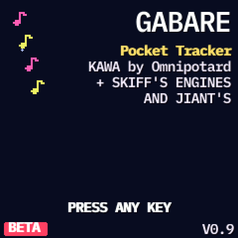

# Gabare — KAWA's tracker, Skiff's and JIANT's engines

**[Install Gabare](index.html)** · [Send a DX7 bank](dx7.html) · [Send samples](samples.html) · [KAWA's manual](manual/index.html)

[Français](README.fr.md) (the full description of what Gabare adds) · **English** · [Español](README.es.md)

Gabare is a free firmware for the **M-VAVE FM-1**: it is [KAWA](https://github.com/Guizmoh/Kawa-Tracker-Fm1) by
Omnipotard (the tracker, its six tracks, its effects, its tools, its installer) with nine more synth engines from two
firmwares of the Felucca family, an arpeggiator on the keys, and DX7 banks on the FM track. Everything KAWA's manual
says holds for Gabare. This first part says what Gabare adds; the rest is KAWA's text.

> **Status: 0.9, beta.** 0.1 to 0.8 were tried on a real FM-1 (ANALOG measured against the simulator, PHYS's load
> measured). STRING, ADD, the arpeggiator and DX7 banks (0.3) pass KAWA's tests and the simulator, not yet all of them
> on the FM-1. 0.4 reads the DX7 bank back over USB (SysEx command 19, see `kawa_sysex.c`), 0.5 adds the FM-1's 128
> original voices to the FM track, 0.6 the ACC cell effect (chords on a track; its load on the FM-1 is still to be
> measured), 0.7 reading the song back over USB (SysEx command 20), 0.8 receiving a song from a computer (SysEx commands
> 21 to 23: the song in RAM is autosaved first and comes back if the new one does not arrive whole; SAVE keeps the new one), 0.9 refusing to write to an unknown flash chip.

## Gabare compared with KAWA

Gabare starts from KAWA 0.10. Anything not listed here is KAWA as it is; in the code every change is marked
"(Gabare)", and [LICENSING.md](LICENSING.md) says who wrote what.

| | KAWA 0.10 | Gabare | Since |
| --- | --- | --- | --- |
| Engines | 6: PULSE, WAVE, NOISE, FM, KIT, SAMPLE | 15: also ANALOG, PHASE, LOFI, VOICE, TRIO, WHEEL, PHYS (Skiff), STRING, ADD (JIANT), with 110 factory sounds | 0.1 (STRING, ADD: 0.3) |
| Load | FM on one track | FM on one track, **PHYS on four at most** | 0.2 |
| Arpeggio | the ARP cell effect | also an **arpeggiator on the keys** (ARPEGGIO page, written by REC) | 0.3 |
| Chords | one note a track | the **ACC** cell effect, up to 4 notes together | 0.6 |
| FM track (**FM SOUND**) | KAWA's 12 FM sounds | also the **FM-1's 128 original voices** (0.5) and a **DX7 bank** of 32 voices (0.3) | 0.3 |
| Song over USB | — | read by a computer (0.7), received from one (0.8) | 0.7 |
| Package | `kawa-X.Y.fwsc`, identity `FM-1_957` | `gabare-X.Y.fwsc`, identity `FM-1_947`, boot screen GABARE | 0.1 |
| Flash chip | both of the FM-1's (since KAWA 0.8): the first units' Puya P25Q80, the UC25HQ80 of those sold from late 2026; any other: no save, no update | the same, and on an unknown chip sending samples or a DX7 bank is refused too | 0.9 |

SysEx commands added to KAWA's 1 to 6 (same frame, see the top of `source/firmware/src/kawa_sysex.c`): INFO says
more (`GABARE`, engines, bank, song size and format, whether a song is accepted, whether the flash chip is known); 16 to 18 write a DX7 bank (0.3),
19 reads it back (0.4); 20 reads the song (0.7); 21 to 23 receive a song (0.8). Pages added: [dx7.html](dx7.html)
(send a DX7 bank) and [aide.html](aide.html) (the cheat sheet, in French); [index.html](index.html) is KAWA's
installer, in French, taking the newest `gabare-*.fwsc`. Projects keep KAWA's format (5): KAWA's projects, samples and
settings load as they are. The [web emulator](emulator/index.html) runs Gabare; KAWA's [manual](manual/index.html)
does not show what Gabare adds. The site (GitHub Pages) deploys from the branch `gabare`, and a version tag (`v0.8`)
has The Firmware Hub's workflow build and sign `gabare-0.8.fwsc`.

## What Gabare adds

- **Fifteen engines.** KAWA's six (PULSE, WAVE, NOISE, FM, KIT, SAMPLE), seven of
  [Skiff](https://github.com/illuminus5/skiff)'s (ANALOG, PHASE, LOFI, VOICE, TRIO, WHEEL, PHYS) and two of
  [JIANT](https://github.com/juanjiant-bit/JIANT)'s (STRING, ADD), with their factory sounds. SOUND page: ARP held +
  PRESETS changes the engine; their 8 knobs are SOUND 1 and 2. FM plays on one track, **PHYS on four at most** (three
  PHYS tracks take 68 % of the FM-1's audio time).
- **An arpeggiator.** SCL goes SCALE → ARPEGGIO → MAGIC. K1 the mode (UP, DOWN, UP+DOWN, RANDOM, AS PLAYED), K2 the
  rate (1/32 .. 1/4 with triplets), K3 the octaves (1..4), K4 the gate; ARP latches the notes. It follows the
  sequencer's rows while playing, and REC writes it into the pattern (one note a row, a DELAY between rows).
- **Chords: the ACC cell effect.** A cell's note plays a chord (up to 4 notes, the 14 chords of ARP) that shares the
  track's envelope, volume and effect. On PULSE, WAVE, FM, ANALOG, PHASE, LOFI and TRIO; the other engines play the
  note alone. Each extra note costs about one more track of that engine; KAWA's load governor drops them first.
- **The FM-1's original voices and DX7 banks.** The FM engine is msfa (Dexed's core). On the FM track, SOUND page, K1
  goes through KAWA's 12 FM sounds, then the FM-1's 128 original voices (M-VAVE firmware V15, published by M-VAVE
  under Apache-2.0 in [fm1_open](https://github.com/m-vave/fm1_open); close to the stock firmware's sound, not
  identical), then the 32 voices of a DX7 bank (`.syx`, 4104 bytes) you send from [dx7.html](dx7.html). One bank at a
  time, kept in flash. Gabare carries no Yamaha sounds: you bring your banks.
- Boot screen GABARE, package identity `FM-1_947`; KAWA's projects, samples and settings load as they are.

Credits: Skiff's engines by illuminus5 (copied unchanged in `source/firmware/src/skiff/`), STRING and ADD by Juan
Ignacio Antonucci (JIANT, adapted to one voice a track), all from Felucca (Leo Kuroshita, Hügelton Instruments),
GPL-3.0; PHYS has models ported from DaisySP and Rings (MIT). See [LICENSING.md](LICENSING.md).

---

## KAWA

*What follows is KAWA's text; it holds for Gabare.*

KAWA is a free tracker firmware for the **M-VAVE FM-1**, made above all for **chiptune and IDM**: 4-bit waves,
pulse and noise like the old consoles, FM, breakbeats cut into slices, rolls and ratchets, stutter and glitch
live effects, tables, a groove, a drive on every track. (It can do other styles, but that is what it is built
for.) Six tracks, a step sequencer you write with the keys, a chain of patterns that makes a song, 64 live
effects and a creative filter. The screen speaks English, French or Spanish.

> **Beta 0.10 — tested on a real FM-1.** It also passes every automatic check (size, memory, an install tested
> against simulated power cuts, the simulator and the web emulator). Installing an
> unofficial firmware is at your own risk, but you can always [go back to the official one](#go-back-to-the-official-firmware-or-install-another-one).

## Start here

| | |
| --- | --- |
| **1. Install** | **[Install from your browser](https://guizmoh.github.io/Kawa-Tracker-Fm1/)** (Chrome or Edge: plug the FM-1 in, click *Install KAWA*). Or download [`kawa-0.10.fwsc`](kawa-0.10.fwsc) and use the [launcher](#install) for your computer. |
| **2. Play** | Switch the FM-1 on and press any key. Press **REC**, play the keys, press **PLAY**. **HOME held** shows the help of the page you are on. |
| **3. Learn** | **[The manual](https://guizmoh.github.io/Kawa-Tracker-Fm1/manual/index.html)** ([FR](https://guizmoh.github.io/Kawa-Tracker-Fm1/manual/fr.html), [ES](https://guizmoh.github.io/Kawa-Tracker-Fm1/manual/es.html)): five short tutorials, from an empty song to a saved one. Or try KAWA right now in the **[web emulator](https://guizmoh.github.io/Kawa-Tracker-Fm1/emulator/index.html)**. |
| **4. Your sounds** | The **[sample importer](https://guizmoh.github.io/Kawa-Tracker-Fm1/samples.html)** puts your own WAV / MP3 / OGG / FLAC files into KAWA over USB. |

| | | |
| --- | --- | --- |
|  |  |  |
|  |  |  |

## What you get

- **A tracker.** Each row is a step, each column a track, each cell a note, a volume and up to two effects (arpeggio,
  glide, roll, chance, delay, reverse, HOP, END…). Patterns of 16, 32 or 64 steps, chained into a song.
- **Six tracks, each with an engine:** pulse, 4-bit wave, noise, 6-operator FM (one track), drum kit or sample.
  Factory sounds for all of them, an ADSR, an effect, an LFO and a modulation page on every sound.
- **Made for chiptune and IDM:** 8 synthesised drum kits and 6 breaks to cut into 16 slices, a **table** on every
  track (a little sequence played inside each note: chip arpeggios, pitch drops, ratchets), a **groove** (7 5, 8 4…),
  Euclid, random and chop tools, 64 live effects in four banks (stutter, retrig, build-up…, and from
  K-GLITCH: DESTROY, BEAT and a realistic scratch, each with its intensity), an 11-type filter, an FX sequencer,
  a drive per track.
- **Your own samples** (4 slots), with an editor: start, end, slices, normalise, reverse.
- **Easy to live with.** The bottom line always says what the four knobs do (KNOB 1 red, 2 yellow, 3 green, 4 blue).
  HOME held opens the help. **Undo / redo cover patterns and sounds** (10 steps). A sound you edited is never replaced
  by mistake. The song is autosaved, plus three project slots. Three themes, four fonts, MIDI clock in and out, a metronome.

## Controls at a glance

| Button | What it does |
| --- | --- |
| **HOME** | The tracks. Held: the help of the page you are on. **HOME + PLAY**: panic (everything stops) |
| **SEQ** | The step grid. **OCT− / OCT+** there: 16, 32 or 64 steps |
| **EDIT** | The sound of the track: SOUND, SOUND 2, (FM operators / sample edit), EFFECT, TABLE. Press again: next page |
| **LFO** | LFO, then MODULATION |
| **ENV** | ENVELOPE, then MIX (levels, pan, sends, master) |
| **FX** | SENDS (drive, echo, reverb per track), then LIVE (64 live effects, 4 banks), FILTER, FX SEQ, then back. Held: LIVE while you hold it |
| **SCL** | SCALE, then MAGIC (beats, melodies, break chops), then back |
| **GLO** | SONG (the chain), GROOVE, OPTIONS (theme, language, clock, font, metronome) |
| **SAVE** | PROJECTS (it blinks while there are unsaved changes). Held: the tools (OPTIONS, UNDO, REDO, CLEAR, COPY, PASTE, RANDOM). **OCT− / OCT+** while held: undo / redo |
| **PLAY**, **REC** | Play / stop; record (the keys write at the cursor, or on the beat while playing) |
| **ARP** | Not an arpeggiator: the **clear / shift** key. A tap on TRACKS clears the cell. Held: + SELECT inserts or deletes a row, + KNOB 3 / 4 edits the cell's second effect, + PRESETS picks the next engine |
| **OCT− / OCT+** | The octave of the keys (other uses on the pages above: bank, add / remove, OK / back) |

| Encoder | What it does |
| --- | --- |
| **SELECT** | Turns the pages of EDIT, LFO, ENV, FX and GLO. Elsewhere: the row, the 16-step page, the menu |
| **ALGORITHM** | The track. On SONG the entry of the chain, on GROOVE the step, on OPTIONS the metronome |
| **PRESETS** | The factory sound (on the first SOUND page), or the page's cursor (operator, table row, slice); the pattern elsewhere |

A **yellow bar** fills at the bottom of the screen when holding a button is about to open something. The 27 keys
play notes on the current track. Everything is explained, with screens, in [the manual](https://guizmoh.github.io/Kawa-Tracker-Fm1/manual/index.html).

## Install

You need a USB **data** cable (not a charge-only one). Switch the FM-1 on, plug it in, close every other MIDI program
(a DAW, M-UPGRADE), then pick one way:

- **From your browser (Chrome, Edge, Opera):** open the [home page](https://guizmoh.github.io/Kawa-Tracker-Fm1/) and click *Install KAWA*.
- **Launcher** (needs [Python 3](https://www.python.org/downloads/)): download this repository (green *Code* button,
  *Download ZIP*), unzip it, then **Windows**: double-click `INSTALL-Windows.bat`; **Mac**: double-click
  `INSTALL-Mac.command` (the first time: right click, Open); **Linux**: `./INSTALL-Linux.sh`.

Either way the package is checked before anything is erased, you are asked to confirm, and the FM-1 restarts into
KAWA. **Do not unplug it while it writes.** A cut install resumes at the next power-on. The chip's bootloader is never
written. If KAWA ever fails to start twice in a row, the FM-1 opens the USB rescue by itself (or hold **OCT−** while
switching on): then run the installer again.

## Go back to the official firmware (or install another one)

1. Your KAWA projects are lost: the official firmware cannot read them. The same goes for any other firmware, and
   KAWA does not read the projects or samples another firmware saved. Projects cannot be copied to a computer yet.
2. Use a stable power supply and a USB data cable. If KAWA misbehaves, open the USB rescue first (OCT− held while switching on).
3. Install M-VAVE's official firmware **V15** with **M-UPGRADE**. KAWA first checks that the tool is M-VAVE's own and that
   its package matches your FM-1; otherwise nothing is written and KAWA keeps running.
4. **Unplug nothing during the transfer** (the official firmware also rewrites the bootloader). If it stops, plug back in and start again.

## Your samples

The **[sample importer](https://guizmoh.github.io/Kawa-Tracker-Fm1/samples.html)** (Chrome or Edge) converts your files
(mono, 22 kHz, normalised, up to 1.66 s each) and sends up to four to the slots MY 1 to MY 4, with KAWA **stopped**.
On a SAMPLE track, choose SOURCE = MY 1 to 4. Without a browser:
`python3 install/kawa_samples.py put 1 my-sound.wav` (and `list`).

## Something wrong?

- **The installer does not find the FM-1:** a data cable, the FM-1 switched on, no other MIDI program open; for the browser, Chrome or Edge.
- **Stuck on the dog:** press any key, KAWA waits for you.
- **Silence:** KAWA starts on an empty song. Write notes (REC, then the keys), or load the demo: SAVE, DEMO, OCT+, PLAY.
- **PRESETS does not change my sound:** you edited it (`*`): it shows the next one in gold, **OCT+** loads it.
- **I made a mistake:** hold SAVE and press OCT− (undo), or SAVE then UNDO.
- **The click is in my recording:** the metronome is also in the USB audio, turn it off (GLO, third page).
- More answers in the [manual](https://guizmoh.github.io/Kawa-Tracker-Fm1/manual/index.html), under *Help*.

## Support KAWA

KAWA is free and open. If you enjoy what I do, consider supporting me! Every little bit means the world!
**[Buy me a beer on Ko-fi](https://ko-fi.com/omnipotard)**.

## Credits and licence

KAWA by Omnipotard. GPL-3.0-only: you may use, change and share it, and whoever receives a firmware built from it
also receives its source code. Built on [Dinghy](https://github.com/zvenson/dinghy) (zvenson),
[Felucca](https://github.com/hugelton/Felucca) (Leo Kuroshita, Hügelton Instruments) and
[SLOOP](https://github.com/isod89/sloop-fm1) (isod89); the FM engine is msfa (Dexed, Apache-2.0). Details in
[LICENSING.md](LICENSING.md). "M-VAVE" and "FM-1" belong to their owners; KAWA is neither made nor endorsed by them.

*For developers:* the source, the build, the tests and the file formats are in [`source/`](source/BUILDING.md).
